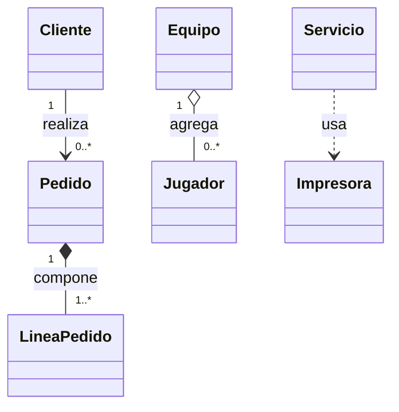

# Programación Orientada a Objetos con Java 21 ☕

Este repositorio es un manual práctico de refuerzo para segundo de DAM. Su propósito no es memorizar palabras, sino aprender a repartir responsabilidades: qué objeto conoce cada dato, qué objeto debe realizar cada operación y cómo colaboran entre sí.

Cada tema sigue el recorrido **problema → idea → sintaxis → ejecución → decisión de diseño → práctica**. Los ejemplos son pequeños y ejecutables sin Maven, Gradle ni bibliotecas externas.

## Índice

1. [Cómo utilizar el repositorio](#cómo-utilizar-el-repositorio)
2. [Clases y objetos](#1-clases-y-objetos)
3. [Constructores y métodos](#2-constructores-y-métodos)
4. [Encapsulamiento](#3-encapsulamiento)
5. [Relaciones entre clases](#4-relaciones-entre-clases)
6. [Herencia](#5-herencia)
7. [Polimorfismo](#6-polimorfismo)
8. [Clases abstractas](#7-clases-abstractas)
9. [Interfaces](#8-interfaces)
10. [Colecciones y objetos](#9-colecciones-y-objetos)
11. [Ejercicios integradores](#10-ejercicios-integradores)
12. [Comparaciones rápidas](#comparaciones-rápidas)

## Introducción: pensar en objetos

En programación estructurada solemos separar los datos de las funciones que los manipulan. Ese enfoque funciona bien en problemas pequeños. Cuando crecen el número de datos y las reglas, es fácil que cualquier parte del programa modifique cualquier valor de forma incoherente.

La POO agrupa **estado** y **comportamiento** en objetos. Una cuenta conoce su saldo y decide si una retirada es válida; un pedido contiene líneas y calcula su total. Una buena clase no es una bolsa de datos: protege sus reglas y ofrece operaciones con significado.

La pregunta principal no es «¿qué clases exige Java?», sino «¿qué responsabilidades existen en el problema y quién debería asumirlas?». Las clases modelan conceptos; los objetos son ejemplares concretos que colaboran durante la ejecución.

## Requisitos

- JDK 21.
- Visual Studio Code con **Extension Pack for Java**, recomendado pero no obligatorio.
- Una terminal.
- Git, si se quiere conservar el historial de cambios.

Comprueba la instalación:

```bash
java -version
javac -version
```

Ambos comandos deberían mostrar la versión 21.

## Cómo utilizar el repositorio

Lee un apartado, predice la salida de su ejemplo y solo entonces ejecútalo. Cambia una cosa cada vez y vuelve a observar el resultado. Después resuelve los ejercicios en orden: esencial, aplicación e integrador.

Cada ejemplo con varias clases vive en su propia carpeta. Desde la raíz, por ejemplo:

```bash
cd 05-herencia/ejemplos/ejemplo01-vehiculos
javac *.java
java Main
```

Los ejemplos de un único archivo se ejecutan de igual manera usando su nombre de clase. Los `.class` son productos de compilación y están ignorados por Git.

---

## 1. Clases y objetos

### ¿Qué problema queremos resolver?

Imagina que guardamos tres alumnos mediante variables sueltas: tres nombres, tres edades y tres notas. Relacionar cada dato con su alumno exige índices paralelos y se vuelve frágil. Necesitamos reunir los datos y operaciones que pertenecen al mismo concepto.

### ¿Qué es?

Una **clase** define la estructura y el comportamiento común de un tipo de objeto. Un **objeto** es una instancia concreta creada a partir de esa definición. Los **atributos** representan su estado y los **métodos**, las acciones que puede realizar.

```java
class Alumno {
    String nombre;                  // atributo
    double nota;

    boolean haAprobado() {          // método
        return nota >= 5;
    }
}

Alumno ana = new Alumno();          // instanciación
```

`new` reserva memoria, inicializa el objeto y devuelve una **referencia**. `ana` no contiene todo el objeto: contiene la referencia que permite acceder a él.

### Identidad, referencias e igualdad

Dos variables pueden apuntar al mismo objeto. En ese caso, una modificación realizada mediante una referencia se observa mediante la otra. Dos objetos distintos también pueden tener el mismo contenido: comparten igualdad lógica, pero no identidad. `==` compara referencias; `equals` puede definir igualdad por contenido (se estudia en el tema 9).

```java
Persona primera = new Persona("Ana");
Persona alias = primera;              // mismo objeto
Persona otraAna = new Persona("Ana"); // objeto distinto
```

### ¿Para qué sirve?

Permite mantener juntos los datos y operaciones de un concepto, crear varios objetos independientes y expresar el dominio con nombres comprensibles.

### ¿Cuándo utilizarlo y cuándo no?

Usa una clase cuando exista un concepto con estado, reglas o comportamiento propio. No inventes una clase para cada operación mínima: una función local puede bastar si no hay estado ni una responsabilidad estable. Tampoco conviertas cada dato en una clase sin aportar significado.

### Ejemplo práctico

[Ejemplo01Persona.java](01-clases-y-objetos/ejemplos/Ejemplo01Persona.java) muestra dos objetos independientes y [Ejemplo02Referencias.java](01-clases-y-objetos/ejemplos/Ejemplo02Referencias.java) muestra dos referencias al mismo objeto.

### Errores frecuentes

- Confundir clase y objeto: `Persona` es el tipo; `new Persona()` crea un ejemplar.
- Declarar una referencia y creer que ya existe un objeto: `Persona p;` no ejecuta ningún constructor.
- Usar una variable local como si fuera atributo: desaparece al terminar el método.
- Comparar contenido con `==`.

### Ejercicios

- [Nivel 1 — Ejercicio01Libro](01-clases-y-objetos/ejercicios/Ejercicio01Libro/README.md)
- [Nivel 2 — Ejercicio02Semaforo](01-clases-y-objetos/ejercicios/Ejercicio02Semaforo/README.md)
- [Nivel 3 — Ejercicio03Aula](01-clases-y-objetos/ejercicios/Ejercicio03Aula/README.md)

---

## 2. Constructores y métodos

### ¿Qué problema queremos resolver?

Un objeto recién creado debería nacer preparado para trabajar. Si primero lo creamos vacío y después recordamos asignar cinco atributos, es posible dejarlo incompleto.

### ¿Qué son y cómo funcionan?

Un **constructor** se ejecuta al usar `new`, tiene el nombre de la clase y no declara tipo de retorno. Si no escribimos ninguno, Java aporta un constructor sin parámetros; en cuanto declaramos uno, deja de aportarlo. La **sobrecarga** permite varias versiones con distinta lista de parámetros.

`this` representa el objeto actual. Sirve para diferenciar un atributo de un parámetro con el mismo nombre y para llamar a otro constructor como primera instrucción.

```java
class Producto {
    String nombre;
    double precio;

    Producto(String nombre) {
        this(nombre, 0);
    }

    Producto(String nombre, double precio) {
        this.nombre = nombre;
        this.precio = precio;
    }

    double precioConIva(double porcentaje) {
        return precio * (1 + porcentaje / 100);
    }
}
```

Un método `void` realiza una acción sin devolver valor. Un método con retorno debe producir un valor compatible en todos sus caminos. Los parámetros son datos de entrada y las variables locales solo existen durante esa llamada.

Los métodos de **instancia** trabajan con un objeto y pueden usar sus atributos. Los `static` pertenecen a la clase y no disponen de `this`; son adecuados para operaciones que no dependen de un ejemplar.

### Sobrecarga frente a sobrescritura

Sobrecargar significa mismo nombre y distintos parámetros, decidido por el compilador. Sobrescribir significa que una subclase reemplaza una implementación heredada, decidido dinámicamente durante la ejecución.

### ¿Cuándo utilizarlo y cuándo no?

Usa constructores para garantizar un estado inicial válido y métodos cuando una operación pertenece a la responsabilidad del objeto. No uses `static` solo para evitar crear objetos ni sobrecargues variantes cuyo significado resulte ambiguo.

### Ejemplo y errores frecuentes

[Ejemplo01CuentaBancaria.java](02-constructores-y-metodos/ejemplos/Ejemplo01CuentaBancaria.java) combina constructores, retorno, `void`, sobrecarga y un método estático.

Errores habituales: escribir un supuesto constructor con `void` (en realidad es un método), olvidar que al añadir un constructor desaparece el constructor implícito, acceder a atributos de instancia desde `static` y sombrear un atributo sin usar `this`.

### Ejercicios

- [Nivel 1 — Ejercicio01Rectangulo](02-constructores-y-metodos/ejercicios/Ejercicio01Rectangulo/README.md)
- [Nivel 2 — Ejercicio02Reserva](02-constructores-y-metodos/ejercicios/Ejercicio02Reserva/README.md)
- [Nivel 3 — Ejercicio03Factura](02-constructores-y-metodos/ejercicios/Ejercicio03Factura/README.md)

---

## 3. Encapsulamiento

### ¿Qué problema queremos resolver?

Si cualquier código puede asignar `saldo = -9000` o `edad = -4`, la clase no puede garantizar sus propias reglas. Buscar quién provocó el estado inválido se vuelve difícil.

### ¿Qué es y para qué sirve?

Encapsular es **controlar el acceso al estado y proteger invariantes**, no generar mecánicamente getters y setters. Una invariante es una condición que debe seguir siendo cierta durante toda la vida del objeto.

- `private`: solo la propia clase.
- sin modificador: mismo paquete.
- `protected`: mismo paquete y subclases; no significa simplemente «privado para hijos».
- `public`: accesible desde cualquier lugar.

```java
class Termostato {
    private double temperatura;

    public Termostato(double temperatura) {
        cambiarTemperatura(temperatura);
    }

    public double getTemperatura() {
        return temperatura;
    }

    public void cambiarTemperatura(double nueva) {
        if (nueva < 5 || nueva > 30) {
            throw new IllegalArgumentException("Temperatura fuera de rango");
        }
        temperatura = nueva;
    }
}
```

Un método como `retirar(cantidad)` expresa mejor la intención que `setSaldo(...)`. Un atributo calculado no necesita setter; un identificador inmutable puede necesitar getter pero nunca setter. Si se devuelve una colección interna directamente, el llamador puede modificarla y romper la encapsulación.

### ¿Cuándo utilizarlo y cuándo no?

Protege siempre el estado que tenga reglas. Ofrece solo las operaciones necesarias. No añadas setters indiscriminados ni validaciones arbitrarias en getters. Para objetos simples e inmutables de datos, un `record` puede ser apropiado, aunque aquí practicamos clases convencionales.

### Ejemplo y errores frecuentes

[Ejemplo01CuentaSegura.java](03-encapsulamiento/ejemplos/Ejemplo01CuentaSegura.java) conserva la invariante `saldo >= 0`.

Es incorrecto hacer público un atributo «por comodidad», validar únicamente en la interfaz de usuario o aceptar un setter que rompe reglas. La clase debe defenderse en cada punto de entrada.

### Ejercicios

- [Nivel 1 — Ejercicio01Temperatura](03-encapsulamiento/ejercicios/Ejercicio01Temperatura/README.md)
- [Nivel 2 — Ejercicio02Inventario](03-encapsulamiento/ejercicios/Ejercicio02Inventario/README.md)
- [Nivel 3 — Ejercicio03Monedero](03-encapsulamiento/ejercicios/Ejercicio03Monedero/README.md)

---

## 4. Relaciones entre clases

### ¿Qué problema queremos resolver?

Los objetos rara vez trabajan aislados: un pedido conoce sus líneas, un alumno pertenece a un grupo y un servicio usa un generador de informes. Necesitamos expresar esas colaboraciones sin convertirlo todo en una única clase gigante.

### Tipos de relación

- **Asociación**: relación estable entre objetos; por ejemplo, un alumno conoce su grupo.
- **Agregación**: relación todo-parte débil. La parte puede existir independientemente; un equipo agrupa jugadores que ya existían.
- **Composición**: propiedad fuerte y ciclo de vida ligado. Un pedido crea y controla sus líneas.
- **Dependencia**: uso puntual, normalmente mediante un parámetro o variable local; un informe recibe una impresora para imprimir.
- **Herencia**: relación «es un», no «tiene un».

Java representa todas las relaciones «tiene un» mediante referencias. El lenguaje no impone automáticamente la diferencia entre agregación y composición: es una decisión conceptual reflejada en quién crea, comparte y controla el ciclo de vida de los objetos.

### Multiplicidad

La multiplicidad expresa cuántas instancias participan: `1`, `0..1`, `*` o `1..*`. Una referencia suele representar uno a uno; una colección, uno a muchos.



### ¿Cómo funciona?

```java
class Pedido {
    private final List<LineaPedido> lineas = new ArrayList<>();

    void agregar(String producto, double precio) {
        lineas.add(new LineaPedido(producto, precio)); // composición conceptual
    }
}
```

### ¿Cuándo utilizarlo y cuándo no?

Usa asociaciones cuando los conceptos deban navegar entre sí; evita referencias bidireccionales si solo una dirección es necesaria. Prefiere composición para combinar capacidades sin crear una jerarquía artificial. Una relación «tiene un motor» no debe modelarse como `Coche extends Motor`.

### Ejemplo y errores frecuentes

[Ejemplo01Pedido](04-relaciones-entre-clases/ejemplos/ejemplo01-pedido/Main.java) muestra composición uno-a-muchos. [Ejemplo02Equipo](04-relaciones-entre-clases/ejemplos/ejemplo02-equipo/Main.java) muestra agregación.

Errores habituales: confundir asociación con herencia, llamar composición a cualquier atributo, crear dependencias circulares y exponer directamente colecciones mutables.

### Ejercicios

- [Nivel 1 — Ejercicio01AutorLibro](04-relaciones-entre-clases/ejercicios/Ejercicio01AutorLibro/README.md)
- [Nivel 2 — Ejercicio02Biblioteca](04-relaciones-entre-clases/ejercicios/Ejercicio02Biblioteca/README.md)
- [Nivel 3 — Ejercicio03CentroEducativo](04-relaciones-entre-clases/ejercicios/Ejercicio03CentroEducativo/README.md)

---

## 5. Herencia

### ¿Qué problema queremos resolver?

Varias clases representan especializaciones reales de un concepto y comparten operaciones. Un coche y una moto son vehículos, aunque cada uno puede desplazarse de manera distinta.

### ¿Qué es y cómo funciona?

Una subclase declara `extends`, hereda miembros accesibles y puede añadir o **sobrescribir** comportamiento. `super(...)` invoca al constructor de la superclase y debe ser la primera instrucción. Los constructores no se heredan.

```java
class Coche extends Vehiculo {
    Coche(String matricula) {
        super(matricula);
    }

    @Override
    public void desplazarse() {
        System.out.println("El coche circula");
    }
}
```

`@Override` permite al compilador verificar que realmente se está sobrescribiendo. Los miembros `private` forman parte del estado del objeto pero no son accesibles directamente desde la subclase. `protected` amplía el acceso y debe usarse con cautela; métodos protegidos suelen ser preferibles a atributos protegidos.

### ¿Cuándo utilizarla y cuándo no?

Úsala cuando exista una relación «es un» estable y la subclase pueda sustituir a la superclase sin romper sus expectativas. No heredes solo para reutilizar unas líneas, no construyas jerarquías profundas y prefiere composición si lo que cambia es una capacidad intercambiable.

### Ejemplo y errores frecuentes

[Ejemplo01HerenciaVehiculos](05-herencia/ejemplos/ejemplo01-vehiculos/Main.java) muestra construcción, `super` y sobrescritura.

Errores: confundir sobrecarga con sobrescritura, reducir la visibilidad de un método sobrescrito, olvidar inicializar la parte heredada o afirmar que `Coche` «tiene un» `Vehiculo` cuando realmente «es un» vehículo.

### Ejercicios

- [Nivel 1 — Ejercicio01Empleados](05-herencia/ejercicios/Ejercicio01Empleados/README.md)
- [Nivel 2 — Ejercicio02Publicaciones](05-herencia/ejercicios/Ejercicio02Publicaciones/README.md)
- [Nivel 3 — Ejercicio03Envios](05-herencia/ejercicios/Ejercicio03Envios/README.md)

---

## 6. Polimorfismo

### ¿Qué problema queremos resolver?

Queremos procesar coches, bicicletas y trenes sin escribir un `if` por cada tipo. Todos son transportes, pero cada uno ejecuta su comportamiento específico.

### ¿Qué es?

El polimorfismo de subtipos permite tratar un objeto de una subclase mediante una referencia de un supertipo. En `Animal animal = new Perro()`, `Animal` es el **tipo declarado** y `Perro` el **tipo real**.

El compilador usa el tipo declarado para decidir qué miembros están disponibles. Al ejecutar un método de instancia sobrescrito, la JVM usa el tipo real: esto es **enlace dinámico**.

```java
Animal animal = new Perro(); // upcasting implícito y seguro
animal.emitirSonido();       // ejecuta Perro.emitirSonido()
```

El tipo declarado no cambia el objeto ni «recorta» su parte de perro. Solo limita lo visible a través de esa referencia.

### Upcasting, downcasting e `instanceof`

El **upcasting** hacia un supertipo es seguro. El **downcasting** pide tratar una referencia como un subtipo más concreto; solo es válido si el objeto real pertenece a ese subtipo. De lo contrario aparece `ClassCastException`.

Java 21 permite pattern matching:

```java
if (animal instanceof Perro perro) {
    perro.moverCola();
}
```

Esto comprueba y convierte en un paso. Aun así, muchos `instanceof` suelen indicar que falta una operación polimórfica en el contrato.

### Colecciones, arrays y parámetros polimórficos

`List<Animal>` y `Animal[]` pueden guardar objetos de diferentes subclases. Un método `void alimentar(Animal animal)` acepta cualquiera de ellas. Así, añadir una nueva subclase no obliga a modificar una cadena central de condicionales: cada objeto sabe responder al mismo mensaje.

### ¿Cuándo utilizarlo y cuándo no?

Úsalo cuando varios tipos compartan un contrato y varíe su implementación. Evita conversiones para preguntar continuamente por el tipo concreto. No fuerces una jerarquía si los tipos no son realmente sustituibles.

### Ejemplos progresivos

1. [Tipo declarado y tipo real](06-polimorfismo/ejemplos/ejemplo01-animales/Main.java).
2. [Colección polimórfica](06-polimorfismo/ejemplos/ejemplo02-figuras/Main.java).
3. [Pattern matching seguro](06-polimorfismo/ejemplos/ejemplo03-pattern-matching/Main.java).

### Errores frecuentes

```java
Animal animal = new Gato();
Perro perro = (Perro) animal; // compila, pero falla en ejecución
```

Otros errores son creer que el tipo declarado decide la implementación ejecutada, intentar acceder a un método exclusivo de `Perro` mediante `Animal`, o sustituir polimorfismo por una larga cadena de comparaciones de tipos.

### Ejercicios

- [Nivel 1 — Ejercicio01Instrumentos](06-polimorfismo/ejercicios/Ejercicio01Instrumentos/README.md)
- [Nivel 2 — Ejercicio02Nominas](06-polimorfismo/ejercicios/Ejercicio02Nominas/README.md)
- [Nivel 3 — Ejercicio03Notificaciones](06-polimorfismo/ejercicios/Ejercicio03Notificaciones/README.md)

---

## 7. Clases abstractas

### ¿Qué problema queremos resolver?

Necesitamos compartir estado y comportamiento entre figuras, pero una «figura genérica» no tiene una fórmula concreta de área y no debería poder instanciarse.

### ¿Qué son y cómo funcionan?

Una clase `abstract` puede tener atributos, constructor, métodos concretos y métodos abstractos sin cuerpo. No se puede instanciar, pero su constructor inicializa la parte común de cada subclase. Una subclase concreta debe implementar los métodos abstractos heredados.

```java
abstract class Figura {
    private final String color;

    protected Figura(String color) { this.color = color; }
    public String getColor() { return color; }
    public abstract double area();
}
```

Una referencia `Figura` puede apuntar a un `Circulo` o `Rectangulo`; por tanto, las clases abstractas también permiten polimorfismo.

### ¿Cuándo utilizarla y cuándo no?

Úsala cuando los subtipos compartan estado o implementación y exista una base conceptual común incompleta. No la uses si solo necesitas un contrato independiente de la jerarquía o herencia múltiple de capacidades: una interfaz encajará mejor.

### Ejemplo y errores frecuentes

[Ejemplo01FigurasAbstractas](07-clases-abstractas/ejemplos/ejemplo01-figuras/Main.java) muestra constructor, método concreto, método abstracto y colección polimórfica.

No se puede escribir `new Figura()`. Un método abstracto no tiene cuerpo y una clase concreta no puede dejarlo sin implementar.

### Ejercicios

- [Nivel 1 — Ejercicio01Electrodomesticos](07-clases-abstractas/ejercicios/Ejercicio01Electrodomesticos/README.md)
- [Nivel 2 — Ejercicio02Personajes](07-clases-abstractas/ejercicios/Ejercicio02Personajes/README.md)
- [Nivel 3 — Ejercicio03Tarifas](07-clases-abstractas/ejercicios/Ejercicio03Tarifas/README.md)

---

## 8. Interfaces

### ¿Qué problema queremos resolver?

Clases sin parentesco natural —una impresora, un informe PDF y una factura— pueden compartir una capacidad, como `Imprimible`. Java solo permite extender una clase, pero permite implementar varias interfaces.

### ¿Qué es y cómo funciona?

Una interfaz define un **contrato**: operaciones que una clase promete ofrecer. Sus métodos sin cuerpo son implícitamente `public abstract`. Puede incluir métodos `default` con una implementación reutilizable y métodos `static` asociados al contrato. Sus campos son constantes `public static final`.

```java
interface Exportable {
    byte[] exportar();

    default boolean estaVacio() {
        return exportar().length == 0;
    }

    static String formatoSoportado() {
        return "binario";
    }
}

class Informe implements Exportable {
    @Override
    public byte[] exportar() { return new byte[] {1, 2}; }
}
```

Una interfaz también es un tipo de referencia: `List<Exportable>` puede reunir implementaciones distintas. `class Robot implements Recargable, Movible` combina varios contratos.

### Interfaz frente a clase abstracta

Una interfaz expresa principalmente una capacidad que pueden compartir clases diferentes y admite implementación múltiple. Una clase abstracta aporta una base con estado y construcción común, pero ocupa la única herencia de clase disponible. No son rivales: una clase abstracta también puede implementar interfaces.

### ¿Cuándo utilizarla y cuándo no?

Úsala en límites entre componentes, para capacidades intercambiables y cuando el código cliente solo deba depender de un contrato. No crees interfaces de una sola implementación sin una razón concreta ni añadas métodos `default` que necesiten estado inexistente.

### Ejemplo y errores frecuentes

[Ejemplo01Pagos](08-interfaces/ejemplos/ejemplo01-pagos/Main.java) muestra dos implementaciones y polimorfismo. [Ejemplo02Capacidades](08-interfaces/ejemplos/ejemplo02-capacidades/Main.java) muestra implementación múltiple, `default` y `static`.

Errores: escribir `extends` al implementar una interfaz, reducir la visibilidad de sus métodos, intentar instanciarla o confundir «heredar implementación y estado» con «cumplir un contrato».

### Ejercicios

- [Nivel 1 — Ejercicio01Reproducibles](08-interfaces/ejercicios/Ejercicio01Reproducibles/README.md)
- [Nivel 2 — Ejercicio02Exportadores](08-interfaces/ejercicios/Ejercicio02Exportadores/README.md)
- [Nivel 3 — Ejercicio03Dispositivos](08-interfaces/ejercicios/Ejercicio03Dispositivos/README.md)

---

## 9. Colecciones y objetos

### ¿Qué problema queremos resolver?

Una aplicación no suele conocer de antemano cuántos objetos gestionará. Un array tiene tamaño fijo; una colección permite crecer, reducirse y ofrecer operaciones de búsqueda.

### Arrays, `List` y genéricos

```java
Producto[] escaparate = new Producto[3];       // tamaño fijo
List<Producto> catalogo = new ArrayList<>();   // tamaño variable
catalogo.add(new Producto("Teclado"));
Producto primero = catalogo.get(0);
int cantidad = catalogo.size();
catalogo.remove(primero);
boolean existe = catalogo.contains(primero);
```

`List` es la interfaz que declara las operaciones y `ArrayList` una implementación. Declarar con el tipo `List` reduce el acoplamiento. El genérico `<Producto>` hace que el compilador rechace elementos de otro tipo y evita conversiones.

Un `for` con índice es útil si se necesita la posición; un `for-each` es más claro para recorrer todos los elementos. No se debe eliminar directamente de una lista dentro de un `for-each`: puede aparecer `ConcurrentModificationException`. Usa `removeIf`, un iterador o separa búsqueda y borrado.

### Igualdad: `==`, `equals` y `hashCode`

`==` comprueba si dos referencias apuntan al mismo objeto. `equals` representa igualdad lógica cuando la clase lo sobrescribe. Las colecciones usan `equals` en operaciones como `contains` y `remove`.

Si se sobrescribe `equals`, también se debe sobrescribir `hashCode`: objetos iguales deben producir el mismo hash. Es imprescindible para colecciones basadas en hash y mantiene coherente el contrato general.

### Colecciones polimórficas

Una `List<Animal>` puede contener `Perro` y `Gato`; una `List<Exportable>` puede contener cualquier objeto que implemente el contrato. Al recorrerla, se ejecuta la implementación correspondiente al tipo real.

### ¿Cuándo utilizarlo y cuándo no?

Usa arrays cuando el tamaño sea fijo o la API los exija. Usa `List` para secuencias variables. No elijas una colección sin pensar en sus operaciones, no uses tipos genéricos crudos como `List lista`, y no expongas una lista interna mutable sin control.

### Ejemplo y errores frecuentes

[Ejemplo01Catalogo](09-colecciones-y-objetos/ejemplos/ejemplo01-catalogo/Main.java) muestra `List`, recorridos, borrado seguro, `equals` y `hashCode`. [Ejemplo02Tareas](09-colecciones-y-objetos/ejemplos/ejemplo02-tareas/Main.java) usa referencias a interfaz.

Errores: acceder fuera de los índices (`IndexOutOfBoundsException`), asumir que `contains` compara todos los atributos automáticamente, modificar durante un `for-each` y confundir capacidad interna con `size()`.

### Ejercicios

- [Nivel 1 — Ejercicio01ListaCompra](09-colecciones-y-objetos/ejercicios/Ejercicio01ListaCompra/README.md)
- [Nivel 2 — Ejercicio02Agenda](09-colecciones-y-objetos/ejercicios/Ejercicio02Agenda/README.md)
- [Nivel 3 — Ejercicio03Flota](09-colecciones-y-objetos/ejercicios/Ejercicio03Flota/README.md)

---

## 10. Ejercicios integradores

Aquí no se indica qué mecanismo de POO utilizar. Antes de programar, identifica conceptos, responsabilidades, reglas y colaboraciones. Escribe ejemplos de uso y decide después la estructura.

- [Ejercicio01BibliotecaMunicipal](10-ejercicios-integradores/Ejercicio01BibliotecaMunicipal/README.md): préstamos, usuarios y catálogo.
- [Ejercicio02TiendaOnline](10-ejercicios-integradores/Ejercicio02TiendaOnline/README.md): productos, pedidos, descuentos y pagos.
- [Ejercicio03GestionAcademica](10-ejercicios-integradores/Ejercicio03GestionAcademica/README.md): alumnado, módulos, matrículas y calificaciones.

## Comparaciones rápidas

| Conceptos | Diferencia esencial |
|---|---|
| Clase / objeto | Definición del tipo / ejemplar concreto en memoria. |
| Atributo / variable local | Estado del objeto / dato temporal de una llamada. |
| `==` / `equals` | Identidad de referencia / igualdad lógica. |
| Sobrecarga / sobrescritura | Distintos parámetros / nueva implementación heredada. |
| «es un» / «tiene un» | Herencia / asociación, agregación o composición. |
| Agregación / composición | Parte independiente / parte con ciclo de vida controlado por el todo. |
| Clase abstracta / interfaz | Base con estado común / contrato de capacidad. |
| Tipo declarado / tipo real | Qué miembros permite el compilador / qué implementación sobrescrita ejecuta la JVM. |
| Método de instancia / `static` | Opera sobre un objeto / pertenece a la clase. |

## Método recomendado para resolver problemas

1. Escribe casos de uso concretos sin pensar todavía en código.
2. Subraya los conceptos relevantes; son candidatos a objetos, no clases automáticas.
3. Asigna cada regla al objeto que posee la información necesaria.
4. Define qué mensajes deben intercambiar los objetos y oculta el resto.
5. Comprueba que ningún objeto pueda quedar en un estado inválido.
6. Prueba primero el caso normal y después límites, errores y colecciones vacías.
7. Revisa si una relación expresa realmente «es un» o «tiene un».

Una solución orientada a objetos es buena cuando sus nombres cuentan el problema, sus responsabilidades están localizadas y cambiar una regla no obliga a recorrer todo el programa.
