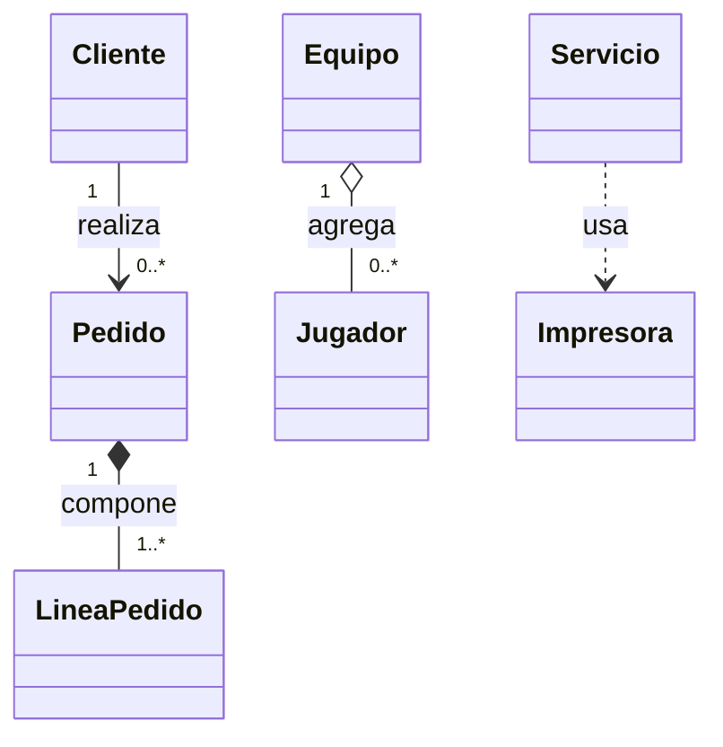

# Programación Orientada a Objetos con Java 21 ☕

**Java 21 · Sin Maven ni dependencias externas**

> 📚 **Material didáctico**
>
> **Profesor y autor:** Christian Bihurriet
> **Centro educativo:** CESUR
>
> Repositorio de material docente elaborado para la enseñanza de la Programación
> Orientada a Objetos con Java.

Este repositorio es un manual práctico de Programación Orientada a Objetos (POO)
para alumnado que ya conoce variables, condicionales y bucles, pero todavía
encuentra difícil decidir qué clases crear, dónde guardar los datos o qué objeto
debe realizar cada operación.

Aprender POO no consiste en memorizar `class`, `private`, `extends` o `interface`.
Consiste en aprender a repartir responsabilidades:

- qué objetos participan en un problema;
- qué información conoce cada objeto;
- qué operaciones debe controlar cada uno;
- qué reglas nunca deberían romperse;
- y cómo colaboran sin conocer detalles innecesarios.

Cada tema sigue el recorrido **problema → intuición → sintaxis → ejecución → decisión
de diseño → práctica**. Los ejemplos son pequeños, ejecutables y no requieren Maven,
Gradle ni bibliotecas externas.

## Índice

- [Introducción: pensar en objetos](#introducción-pensar-en-objetos)
- [Requisitos](#requisitos)
- [Cómo utilizar el repositorio](#cómo-utilizar-el-repositorio)

### Temario

1. [Clases y objetos](#1-clases-y-objetos)
2. [Constructores y métodos](#2-constructores-y-métodos)
3. [Encapsulamiento](#3-encapsulamiento)
4. [Relaciones entre clases](#4-relaciones-entre-clases)
5. [Herencia](#5-herencia)
6. [Polimorfismo](#6-polimorfismo)
7. [Clases abstractas](#7-clases-abstractas)
8. [Interfaces](#8-interfaces)
9. [Colecciones y objetos](#9-colecciones-y-objetos)
10. [Ejercicios integradores](#10-ejercicios-integradores)

### Consulta rápida

- [Comparaciones rápidas](#comparaciones-rápidas)
- [Método recomendado para resolver problemas](#método-recomendado-para-resolver-problemas)
- [Lista de comprobación final](#lista-de-comprobación-final)
- [Sobre este repositorio](#sobre-este-repositorio)

## Introducción: pensar en objetos

En programación estructurada, los datos se pueden guardar en variables y procesar
mediante funciones. El enfoque es válido, pero una aplicación grande
puede acabar con muchas funciones capaces de modificar cualquier dato. Entonces es
difícil saber quién protege cada regla.

Imagina una cuenta representada solo por `double saldo = 100;`. Si cualquier parte
del programa puede ejecutar `saldo = -500`, no existe un responsable que lo impida.
La POO reúne el estado y las operaciones que lo controlan:

```java
class Cuenta {
    private double saldo;

    boolean retirar(double cantidad) {
        if (cantidad <= 0 || cantidad > saldo) return false;
        saldo -= cantidad;
        return true;
    }
}
```

La cuenta ya no es una bolsa de datos: conoce su saldo y decide si una retirada es
válida. Esta idea —poner cada regla cerca de los datos que necesita— guía todo el
manual.

> **Idea central:** una buena clase representa un concepto y asume una
> responsabilidad clara. No se crea una clase solo para repartir código en archivos.

## Requisitos

- JDK 21.
- Visual Studio Code con **Extension Pack for Java**, recomendado pero no obligatorio.
- Una terminal.
- Git, si se quiere conservar el historial de cambios.

Comprueba la instalación:

```bash
java -version
javac -version
```

Ambos comandos deberían mostrar la versión 21.

## Cómo utilizar el repositorio

Para cada tema sigue este proceso:

1. Lee el problema que se intenta resolver.
2. Antes de ejecutar un ejemplo, predice su salida y el estado final de los objetos.
3. Compila y compara el resultado con tu predicción.
4. Cambia una sola cosa y vuelve a ejecutar.
5. Explica con tus palabras el nuevo resultado.
6. Resuelve los ejercicios en orden: esencial, aplicación e integrador.

Cada ejemplo con varias clases vive en su propia carpeta. Desde la raíz:

```bash
cd 05-herencia/ejemplos/ejemplo01-vehiculos
javac *.java
java Main
```

Un ejemplo de un único archivo se ejecuta indicando su nombre:

```bash
javac Ejemplo01Persona.java
java Ejemplo01Persona
```

### Cómo interpretar los bloques de código

En este manual se distinguen dos tipos de ejemplos:

- **Bloque ejecutable:** se indica expresamente y contiene todo lo necesario para
  compilarse o ejecutarse en el contexto señalado. Los comandos `bash` anteriores
  son ejecutables desde las carpetas indicadas. Los ejemplos enlazados del
  repositorio también son programas completos.
- **Fragmento ilustrativo:** enseña una idea concreta y puede omitir `main`,
  importaciones, constructores o clases ya explicadas. Salvo que se indique
  «ejemplo completo ejecutable», los bloques Java de este README deben interpretarse
  como fragmentos ilustrativos.

Cuando varios fragmentos de una sección utilizan las mismas clases o variables, se
indica que son **acumulativos**: el bloque posterior continúa conceptualmente el
anterior. No copies un fragmento aislado esperando que compile si depende de ese
contexto. Para experimentar directamente, utiliza los archivos enlazados al final de
cada tema.

`javac` traduce el código a archivos `.class`. `java` inicia la JVM y ejecuta
`main`. Los `.class` son productos de compilación y están ignorados por Git.

Cuando algo falle, lee el primer mensaje completo: archivo, línea y símbolo. Un
error de compilación impide construir el programa; una excepción ocurre cuando un
programa ya compilado encuentra una situación que no puede continuar.

---

## 1. Clases y objetos

### El problema: datos que pertenecen juntos

Para guardar tres alumnos con variables sueltas harían falta `nombre1`, `edad1`,
`nota1`, después `nombre2`, etc. Nada garantiza que los datos sigan emparejados. Una
clase permite describir qué datos y comportamientos forman el concepto «alumno».

### Clase, objeto y referencia

Una **clase** define un tipo. Un **objeto** es un ejemplar concreto de ese tipo. Una
**referencia** es la variable que permite localizar y utilizar el objeto.

```java
class Alumno {
    String nombre;
    double nota;

    boolean haAprobado() {
        return nota >= 5;
    }
}

Alumno ana = new Alumno();
ana.nombre = "Ana";
ana.nota = 7.5;

Alumno omar = new Alumno();
omar.nombre = "Omar";
omar.nota = 4.5;
```

La clase es el molde; `new` crea los objetos. La memoria puede representarse así:

```text
ana  ───► Alumno { nombre: "Ana",  nota: 7.5 }
omar ───► Alumno { nombre: "Omar", nota: 4.5 }
```

Al ejecutar `ana.haAprobado()` ocurre lo siguiente:

1. `ana` localiza su objeto.
2. Java entra en el método de ese objeto.
3. `nota` vale `7.5` porque se usa el estado de Ana.
4. Se evalúa `7.5 >= 5` y se devuelve `true`.

El mismo método ejecutado mediante `omar` usa la nota de Omar y devuelve `false`.

### Identidad y alias

Dos variables pueden apuntar al mismo objeto:

```java
Alumno primeraReferencia = new Alumno();
Alumno alias = primeraReferencia;
alias.nota = 9;
System.out.println(primeraReferencia.nota); // 9.0
```

No se creó otro alumno; se copió la referencia. Dos usos de `new`, en cambio, crean
objetos distintos aunque tengan el mismo contenido. `==` compara su identidad. La
igualdad lógica mediante `equals` se estudiará en el tema 9.

### Atributos, parámetros y variables locales

- Un **atributo** pertenece al objeto y conserva su valor.
- Un **parámetro** recibe un dato al llamar a un método.
- Una **variable local** existe solo durante esa llamada.

```java
class Contador {
    int valor;                    // atributo

    void aumentar(int cantidad) { // parámetro
        int anterior = valor;     // variable local
        valor = anterior + cantidad;
    }
}
```

### Errores frecuentes y decisiones

- `Alumno alumno;` declara una referencia, pero todavía no crea ningún objeto.
- Dos referencias al mismo objeto no tienen estados separados.
- Dos objetos con los mismos datos no son automáticamente la misma referencia.
- El contenido de `String` se compara con `equals`, no con `==`.
- Un dato que el objeto debe recordar debe ser atributo, no variable local.

Crea una clase cuando exista un concepto con identidad, estado o comportamiento
propio. No conviertas automáticamente cada número o texto en una clase.

### Ejemplos y ejercicios

[Ejemplo01Persona.java](01-clases-y-objetos/ejemplos/Ejemplo01Persona.java) muestra
objetos independientes y [Ejemplo02Referencias.java](01-clases-y-objetos/ejemplos/Ejemplo02Referencias.java)
muestra referencias compartidas.

- [Nivel 1 — Ejercicio01Libro](01-clases-y-objetos/ejercicios/Ejercicio01Libro/README.md)
- [Nivel 2 — Ejercicio02Semaforo](01-clases-y-objetos/ejercicios/Ejercicio02Semaforo/README.md)
- [Nivel 3 — Ejercicio03Aula](01-clases-y-objetos/ejercicios/Ejercicio03Aula/README.md)

Al terminar deberías explicar por qué dos semáforos creados con dos llamadas a `new`
avanzan de forma independiente.

---

## 2. Constructores y métodos

### El problema: objetos incompletos

Un objeto recién creado recibe valores predeterminados (`0`, `false` o `null`). Si
después hay que asignar cinco atributos manualmente, es posible olvidar alguno. Un
**constructor** recibe los datos necesarios y prepara el objeto al crearlo.

```java
class Producto {
    String nombre;
    double precio;

    Producto(String nombre, double precio) {
        this.nombre = nombre;
        this.precio = precio;
    }
}

Producto teclado = new Producto("Teclado", 35.50);
```

### Qué ocurre con `new`

1. La JVM reserva memoria para el objeto.
2. Los atributos reciben valores predeterminados.
3. Se ejecuta el constructor con los argumentos.
4. `this.nombre` es el atributo; `nombre` es el parámetro.
5. El constructor termina y `new` devuelve la referencia.

El constructor tiene el nombre de la clase y no declara retorno. `void Producto(...)`
sería un método normal, no un constructor.

### Métodos que preguntan y métodos que ordenan

```java
double calcularPrecioConIva(double porcentaje) {
    return precio * (1 + porcentaje / 100);
}

void aplicarDescuento(double cantidad) {
    precio -= cantidad;
}
```

El primer método devuelve un valor; el segundo modifica estado. Un retorno no se
muestra solo: quien llama decide si guardarlo, mostrarlo o usarlo en otro cálculo.

### Sobrecarga

La sobrecarga permite el mismo nombre con parámetros diferentes:

```java
Producto(String nombre) {
    this(nombre, 0);
}

Producto(String nombre, double precio) {
    this.nombre = nombre;
    this.precio = precio;
}
```

`this(nombre, 0)` llama a otro constructor y debe ser su primera instrucción. Java
elige una sobrecarga por los argumentos, nunca solo por el tipo de retorno.

### Instancia y `static`

Un método de instancia trabaja con un objeto y puede usar sus atributos. Un método
`static` pertenece a la clase y no dispone de `this`:

```java
class Conversor {
    static double eurosACentimos(double euros) {
        return euros * 100;
    }
}
```

Úsalo cuando la operación no dependa del estado de un ejemplar, no solo para evitar
crear objetos.

### Datos almacenados y calculados

Si el total de una factura siempre es `unidades * precioUnitario`, guardarlo además
como atributo crea dos fuentes de verdad. Es mejor calcularlo mediante un método.

### Errores frecuentes

- Añadir `void` al constructor.
- Olvidar que al escribir un constructor desaparece el constructor implícito.
- Escribir `nombre = nombre` en vez de `this.nombre = nombre`.
- Acceder a atributos de instancia desde `static`.
- Olvidar `return` en algún camino.
- Guardar un resultado que puede derivarse de otros datos.

[Ejemplo01CuentaBancaria.java](02-constructores-y-metodos/ejemplos/Ejemplo01CuentaBancaria.java)
combina constructores, retorno, `void`, sobrecarga y un método estático.

- [Nivel 1 — Ejercicio01Rectangulo](02-constructores-y-metodos/ejercicios/Ejercicio01Rectangulo/README.md)
- [Nivel 2 — Ejercicio02Reserva](02-constructores-y-metodos/ejercicios/Ejercicio02Reserva/README.md)
- [Nivel 3 — Ejercicio03Factura](02-constructores-y-metodos/ejercicios/Ejercicio03Factura/README.md)

---

## 3. Encapsulamiento

### El problema: cualquiera puede romper el objeto

Si cualquier código puede ejecutar `cuenta.saldo = -9000`, la cuenta no controla sus
reglas. **Encapsular** es controlar el acceso y obligar a modificar el estado mediante
operaciones con significado.

```java
class Cuenta {
    private double saldo;

    Cuenta(double saldoInicial) {
        if (saldoInicial < 0) {
            throw new IllegalArgumentException("Saldo no válido");
        }
        saldo = saldoInicial;
    }

    double getSaldo() {
        return saldo;
    }

    boolean retirar(double cantidad) {
        if (cantidad <= 0 || cantidad > saldo) return false;
        saldo -= cantidad;
        return true;
    }
}
```

### Invariantes y puntos de entrada

Una **invariante** es una condición que debe mantenerse durante toda la vida válida
del objeto. Aquí es `saldo >= 0`. Debe protegerse en el constructor y en toda
operación capaz de modificar el saldo. Validar solo en `main` no sirve si otro código
usa la clase directamente.

### Acceso y operaciones expresivas

- `private`: solo la propia clase.
- sin modificador: mismo paquete.
- `protected`: paquete y subclases.
- `public`: cualquier código que vea la clase.

Empieza con el acceso más restrictivo. Un getter no obliga a crear un setter. Un
identificador puede necesitar consulta y no modificación. `reponer(unidades)` o
`retirar(unidades)` explican mejor la intención que `setExistencias(valor)`.

`final` permite asignar un atributo una sola vez, por lo que resulta apropiado para
identificadores inmutables.

### Rechazar sin modificar

Si una cuenta con 80 recibe `retirar(100)`, la condición falla, se devuelve `false`
y la resta no se ejecuta. El saldo sigue siendo 80. Una operación rechazada no debe
dejar cambios parciales.

Una entrada imposible, como una cantidad negativa, puede lanzar
`IllegalArgumentException`. Una situación normal de negocio, como saldo insuficiente,
puede devolver `false`. La elección debe ser clara y consistente.

### Errores frecuentes

- Hacer públicos los atributos por comodidad.
- Generar setters para todos los campos.
- Validar fuera de la clase y confiar en que nadie la usará de otra manera.
- Modificar primero y comprobar después.
- Devolver directamente una colección interna mutable.
- Creer que encapsular consiste únicamente en escribir `private`.

[Ejemplo01CuentaSegura.java](03-encapsulamiento/ejemplos/Ejemplo01CuentaSegura.java)
conserva la invariante `saldo >= 0`.

- [Nivel 1 — Ejercicio01Temperatura](03-encapsulamiento/ejercicios/Ejercicio01Temperatura/README.md)
- [Nivel 2 — Ejercicio02Inventario](03-encapsulamiento/ejercicios/Ejercicio02Inventario/README.md)
- [Nivel 3 — Ejercicio03Monedero](03-encapsulamiento/ejercicios/Ejercicio03Monedero/README.md)

Antes de programar, escribe la invariante de cada ejercicio en una frase.

---

## 4. Relaciones entre clases

### El problema: los objetos colaboran

Una aplicación real no cabe en una clase. Un libro tiene autor, un pedido contiene
líneas y un grupo reúne alumnado. En Java estas relaciones se representan mediante
referencias:

```java
class Libro {
    private final String titulo;
    private final Autor autor;
}
```

`Libro` no copia un autor: conserva una referencia a un objeto `Autor`.

### Tipos de relación

- **Asociación:** un objeto conoce a otro; por ejemplo, un libro conoce a su autor.
- **Agregación:** el todo agrupa partes independientes. Un equipo recibe jugadores
  que ya existían y podrían seguir existiendo sin ese equipo.
- **Composición:** el todo crea o controla fuertemente sus partes. Una línea creada
  por un pedido no suele tener sentido fuera de él.
- **Dependencia:** uso puntual mediante un parámetro o variable local.
- **Herencia:** relación «es un», no «tiene un».

Java usa referencias tanto para asociación como para agregación y composición. La
diferencia se reconoce observando quién crea, comparte y controla el ciclo de vida.

### Multiplicidad y dirección

La multiplicidad expresa cuántos objetos participan: `1`, `0..1`, `0..*` o `1..*`.
Una referencia suele representar uno; una colección representa muchos.



No toda relación necesita navegación en ambas direcciones. Si solo se necesita conocer
el autor de un libro, basta `Libro -> Autor`. Añadir también los libros al autor
obliga a mantener dos lados sincronizados sin aportar utilidad.

### Introducción mínima a `ArrayList`

Para representar una relación «uno a muchos» es necesario guardar una cantidad de
objetos que no siempre se conoce de antemano. Un array obliga a decidir su tamaño al
crearlo. Un `ArrayList`, en cambio, puede crecer a medida que se añaden elementos.

Antes de usarlo hay que importar `List` y `ArrayList`:

```java
import java.util.ArrayList;
import java.util.List;
```

Una lista vacía se puede crear y completar así:

> **Fragmento ilustrativo:** presupone que la clase `LineaPedido` ya existe y posee
> el constructor mostrado.

```java
List<LineaPedido> lineas = new ArrayList<>();

lineas.add(new LineaPedido("Teclado", 35));
lineas.add(new LineaPedido("Ratón", 20));

System.out.println(lineas.size()); // 2
```

Esta declaración contiene tres ideas:

- `List<LineaPedido>` es el tipo de la variable: una lista que solo admite
  `LineaPedido`.
- `new ArrayList<>()` crea el objeto que almacenará los elementos.
- `add(...)` incorpora un elemento y `size()` indica cuántos contiene.

El símbolo `<>` pertenece a los **genéricos**. Por ahora basta entender que evita
mezclar accidentalmente líneas de pedido con objetos de otro tipo. En el tema 9 se
estudiarán las listas, sus operaciones y los recorridos con detalle.

### Uno a muchos con `List`

Esta herramienta permite que un pedido conserve sus líneas:

> **Fragmento ilustrativo:** muestra únicamente la relación entre `Pedido` y
> `LineaPedido`; no incluye la definición de `LineaPedido` ni un método `main`.

```java
import java.util.ArrayList;
import java.util.List;

class Pedido {
    private final List<LineaPedido> lineas = new ArrayList<>();

    void agregar(String producto, double precio) {
        lineas.add(new LineaPedido(producto, precio));
    }
}
```

Al crear el pedido también nace una lista vacía. Cada llamada a `agregar` crea una
línea y la incorpora mediante `add`. El pedido controla sus partes y no entrega
directamente la lista mutable.

### Repartir responsabilidades

Pregunta quién posee la información. Una línea conoce cantidad y precio, por lo que
puede calcular su importe. El pedido conoce todas las líneas, por lo que puede sumar
el total. Así cada regla queda localizada.

### Errores frecuentes

- Usar herencia para una relación «tiene un».
- Crear una clase gigante con todos los datos.
- Añadir referencias inversas que ningún caso de uso necesita.
- Llamar composición a cualquier atributo.
- Exponer listas mutables y perder el control de las reglas.

Estudia primero la [asociación entre Autor y Libro](04-relaciones-entre-clases/ejemplos/ejemplo00-asociacion-autor-libro/Main.java).
Después, [Ejemplo01Pedido](04-relaciones-entre-clases/ejemplos/ejemplo01-pedido/Main.java)
muestra composición y [Ejemplo02Equipo](04-relaciones-entre-clases/ejemplos/ejemplo02-equipo/Main.java)
muestra agregación.

- [Nivel 1 — Ejercicio01AutorLibro](04-relaciones-entre-clases/ejercicios/Ejercicio01AutorLibro/README.md)
- [Nivel 2 — Ejercicio02Biblioteca](04-relaciones-entre-clases/ejercicios/Ejercicio02Biblioteca/README.md)
- [Nivel 3 — Ejercicio03CentroEducativo](04-relaciones-entre-clases/ejercicios/Ejercicio03CentroEducativo/README.md)

Dibuja primero los objetos y flechas; transforma después cada flecha necesaria en
una referencia o lista.

---

## 5. Herencia

### El problema: especializaciones de un concepto

Un coche y una moto comparten datos y operaciones porque ambos **son vehículos**.
La herencia expresa esa relación «es un».

```java
class Vehiculo {
    private final String matricula;

    Vehiculo(String matricula) {
        this.matricula = matricula;
    }

    void desplazarse() {
        System.out.println("El vehículo se desplaza");
    }
}

class Coche extends Vehiculo {
    Coche(String matricula) {
        super(matricula);
    }

    @Override
    void desplazarse() {
        System.out.println("El coche circula");
    }
}
```

### Construcción paso a paso

Al ejecutar `new Coche("1234 ABC")`:

1. Se reserva memoria para el objeto completo.
2. El constructor de `Coche` llama a `super(...)`.
3. `Vehiculo` inicializa la parte heredada.
4. Termina el constructor padre.
5. Continúa y termina el constructor de `Coche`.

Los constructores no se heredan. `super(...)` debe ser la primera instrucción.

### Sobrescritura frente a sobrecarga

**Sobrecargar** es usar el mismo nombre con parámetros distintos. El compilador
elige la versión. **Sobrescribir** es reemplazar en una subclase la implementación de
la misma firma. `@Override` permite al compilador comprobar nuestra intención.

Una sobrescritura puede reutilizar el comportamiento anterior:

```java
@Override
double calcularPrecio() {
    return super.calcularPrecio() + 5;
}
```

Los miembros `private` siguen formando parte del objeto, pero la subclase no accede
directamente. La superclase puede proporcionar un getter o una operación protegida.
Hacer todos los atributos `protected` debilita la encapsulación.

### Cuándo usarla

Comprueba si la subclase es realmente un caso particular y puede sustituir a la
superclase sin romper expectativas. Un coche **tiene un** motor, no **es un** motor:
ahí corresponde composición. No heredes solo para reutilizar unas líneas ni crees
jerarquías profundas sin necesidad.

### Errores frecuentes

- Confundir «es un» y «tiene un».
- Creer que los constructores se heredan.
- Olvidar inicializar la parte padre.
- Acceder directamente a atributos privados heredados.
- Cambiar por error la firma y no sobrescribir realmente.

[Ejemplo01HerenciaVehiculos](05-herencia/ejemplos/ejemplo01-vehiculos/Main.java)
muestra construcción, `super` y sobrescritura.

- [Nivel 1 — Ejercicio01Empleados](05-herencia/ejercicios/Ejercicio01Empleados/README.md)
- [Nivel 2 — Ejercicio02Publicaciones](05-herencia/ejercicios/Ejercicio02Publicaciones/README.md)
- [Nivel 3 — Ejercicio03Envios](05-herencia/ejercicios/Ejercicio03Envios/README.md)

En cada ejercicio escribe primero la frase «X es un Y». Si no tiene sentido, revisa
el diseño.

---

## 6. Polimorfismo

### El problema: procesar tipos distintos del mismo modo

El tema anterior mostró que `Perro` y `Gato` pueden heredar de `Animal`. El siguiente
objetivo es recorrerlos, pasarlos a métodos y hacerlos trabajar sin escribir un caso
especial para cada subtipo.

Una solución frágil sería guardar el tipo en un texto y preguntar continuamente:

```java
if (tipo.equals("perro")) {
    System.out.println("Guau");
} else if (tipo.equals("gato")) {
    System.out.println("Miau");
}
```

Cada animal nuevo obligaría a modificar ese bloque. El polimorfismo traslada el
comportamiento al objeto responsable: todos reciben el mensaje `emitirSonido()`, pero
cada objeto sabe cómo responder.

### Paso 1: una jerarquía con comportamiento sobrescrito

El punto de partida es una superclase concreta y dos subclases:

> **Fragmentos acumulativos:** la jerarquía siguiente es el contexto de todos los
> bloques del tema 6. Las llamadas posteriores suponen que estas clases ya están
> declaradas. Los programas completos están enlazados al final del tema.

```java
class Animal {
    void emitirSonido() {
        System.out.println("Sonido de animal");
    }
}

class Perro extends Animal {
    @Override
    void emitirSonido() {
        System.out.println("Guau");
    }

    void moverCola() {
        System.out.println("El perro mueve la cola");
    }
}

class Gato extends Animal {
    @Override
    void emitirSonido() {
        System.out.println("Miau");
    }
}
```

Cada tipo concreto todavía puede utilizarse de la forma habitual:

```java
Perro perro = new Perro();
Gato gato = new Gato();

perro.emitirSonido(); // Guau
gato.emitirSonido();  // Miau
```

Aquí ya existe sobrescritura, pero aún no se aprovecha una referencia común.

### Paso 2: upcasting y dos tipos para una misma expresión

Una referencia del supertipo puede apuntar a un objeto de cualquier subtipo:

```java
Animal animal = new Perro();
```

Esta asignación se llama **upcasting**. Es implícita y segura porque todo `Perro` es
también un `Animal`.

Conviene distinguir siempre:

| Elemento | En el ejemplo | Para qué se utiliza |
|---|---|---|
| Tipo declarado | `Animal` | El compilador decide qué miembros permite usar |
| Tipo real | `Perro` | La JVM decide qué método sobrescrito ejecuta |
| Referencia | `animal` | Permite acceder al objeto |
| Objeto | `new Perro()` | Conserva el estado y comportamiento reales |

El objeto no se transforma ni pierde su parte de perro. Solo se observa a través de
una referencia más general.

### Paso 3: enlace dinámico

```java
Animal animal = new Perro();
animal.emitirSonido(); // Guau
```

La llamada se resuelve en dos momentos:

1. Al compilar, Java comprueba que `emitirSonido()` existe en el tipo declarado
   `Animal`. Si no existiera, el código no compilaría.
2. Al ejecutar, la JVM observa que el objeto real es `Perro` y selecciona la
   sobrescritura de `Perro`.

Esta selección durante la ejecución se denomina **enlace dinámico**. Si después la
referencia apunta a un gato, la misma línea ejecuta otra implementación:

```java
animal = new Gato();
animal.emitirSonido(); // Miau
```

### Paso 4: parámetros polimórficos

Un método que recibe el supertipo puede trabajar con cualquier subtipo:

```java
static void hacerSonar(Animal animal) {
    animal.emitirSonido();
}

hacerSonar(new Perro()); // Guau
hacerSonar(new Gato());  // Miau
```

`hacerSonar` no pregunta qué clase ha recibido. Confía en el contrato ofrecido por
`Animal`. Si mañana aparece `Pajaro extends Animal`, el método puede utilizarlo sin
cambiar su cuerpo.

Este es un primer beneficio práctico: el código que usa animales queda separado del
código que define el sonido de cada animal.

### Paso 5: arrays polimórficos

Un array del supertipo puede guardar objetos de diferentes subtipos:

```java
Animal[] animales = {
    new Perro(),
    new Gato(),
    new Perro()
};

for (Animal animal : animales) {
    animal.emitirSonido();
}
```

La salida es:

```text
Guau
Miau
Guau
```

Seguimiento de la primera vuelta:

1. La variable `animal` se declara como `Animal`.
2. Recibe la referencia al primer objeto, cuyo tipo real es `Perro`.
3. El compilador ya comprobó que `Animal` declara `emitirSonido()`.
4. La JVM ejecuta `Perro.emitirSonido()`.
5. En la siguiente vuelta la variable es la misma, pero apunta a otro objeto.

El bucle contiene una única llamada y no necesita `if`, `switch` ni `instanceof`.

### Paso 6: añadir un subtipo sin modificar el recorrido

```java
class Pajaro extends Animal {
    @Override
    void emitirSonido() {
        System.out.println("Pío");
    }
}
```

Basta añadir `new Pajaro()` al array. El bucle continúa siendo idéntico. Este diseño
es más extensible porque la variación se encuentra en las subclases, no en el código
que las recorre.

### Qué permite usar el tipo declarado

```java
Animal animal = new Perro();
animal.emitirSonido(); // correcto
animal.moverCola();    // no compila
```

Aunque el objeto real sea un perro, `moverCola()` no forma parte del tipo declarado
`Animal`. Esto es intencionado: el código que trabaja con animales solo debería
depender de operaciones comunes.

Si esa acción debe estar disponible para todos, quizá falte incorporarla al diseño
común. Si es exclusivamente canina, solo debe usarse cuando el caso requiera
realmente un `Perro`.

### Downcasting e `instanceof`

El **downcasting** convierte explícitamente una referencia general en otra más
concreta:

```java
Animal animal = new Perro();
Perro perro = (Perro) animal;
perro.moverCola();
```

Compilar no garantiza que la conversión sea válida. Esto falla durante la ejecución:

```java
Animal animal = new Gato();
Perro perro = (Perro) animal; // ClassCastException
```

Java 21 permite comprobar y convertir de forma segura con pattern matching:

```java
if (animal instanceof Perro perro) {
    perro.moverCola();
}
```

Utiliza esta técnica solo cuando el caso de uso necesita de verdad una operación del
subtipo. Si el programa pregunta constantemente por la clase concreta para decidir
el comportamiento principal, probablemente falta polimorfismo.

### Lo que no es polimorfismo

- No es crear dos métodos sobrecargados con parámetros diferentes.
- No es guardar el nombre de la clase en un `String`.
- No es convertir todos los objetos a su subtipo antes de usarlos.
- No significa que todos los subtipos hagan exactamente lo mismo; comparten el
  mensaje, pero varía su implementación.

### Errores frecuentes

- Confundir el tipo de la variable con el tipo del objeto.
- Creer que el tipo declarado decide la sobrescritura ejecutada.
- Intentar llamar a miembros exclusivos del subtipo mediante el supertipo.
- Hacer downcasting sin comprobar el tipo real.
- Usar `instanceof` para reemplazar un método sobrescrito.
- Repetir varios bucles para subtipos que podrían compartir uno.

### Ejemplos del repositorio

Estúdialos en este orden:

1. [Tipo declarado y tipo real](06-polimorfismo/ejemplos/ejemplo01-animales/Main.java).
2. [Recorrido polimórfico de figuras](06-polimorfismo/ejemplos/ejemplo02-figuras/Main.java).
3. [Pattern matching seguro](06-polimorfismo/ejemplos/ejemplo03-pattern-matching/Main.java).
4. [Array polimórfico](06-polimorfismo/ejemplos/ejemplo04-array-polimorfico/Main.java).
5. [Parámetro del tipo padre](06-polimorfismo/ejemplos/ejemplo05-parametro-polimorfico/Main.java).
6. [Upcasting, downcasting y errores de conversión](06-polimorfismo/ejemplos/ejemplo06-conversiones/Main.java).

En cada llamada anota primero qué verifica el compilador y después qué
implementación seleccionará la JVM.

### Ejercicios

- [Nivel 1 — Ejercicio01Instrumentos](06-polimorfismo/ejercicios/Ejercicio01Instrumentos/README.md)
- [Nivel 2 — Ejercicio02Nominas](06-polimorfismo/ejercicios/Ejercicio02Nominas/README.md)
- [Nivel 3 — Ejercicio03Notificaciones](06-polimorfismo/ejercicios/Ejercicio03Notificaciones/README.md)

Antes de escribir los bucles, comprueba que el método llamado aparezca en el
supertipo y que cada subtipo lo sobrescriba. El cuerpo del bucle no debería preguntar
por tipos concretos.

---

## 7. Clases abstractas

### El problema: una base útil pero incompleta

Un círculo y un rectángulo comparten color y descripción, pero una «figura genérica»
no tiene fórmula concreta de área. Una clase abstracta comparte la base y obliga a
cada subtipo a completar lo que falta.

```java
abstract class Figura {
    private final String color;

    Figura(String color) {
        this.color = color;
    }

    String getColor() { return color; }

    void mostrarDescripcion() {
        System.out.println("Figura " + color);
    }

    abstract double calcularArea();
}
```

Puede tener estado, constructor, métodos concretos y métodos abstractos, pero no
puede instanciarse.

```java
class Rectangulo extends Figura {
    private final double base;
    private final double altura;

    Rectangulo(String color, double base, double altura) {
        super(color);
        this.base = base;
        this.altura = altura;
    }

    @Override
    double calcularArea() {
        return base * altura;
    }
}
```

Aunque no pueda escribirse `new Figura()`, su constructor sí se ejecuta al crear un
rectángulo. Una subclase concreta debe implementar todos los métodos abstractos.

Las referencias `Figura` permiten recorrer subtipos polimórficamente: se reutilizan
los métodos concretos y se ejecuta el cálculo específico del objeto real.

### Cuándo usarla y errores frecuentes

Úsala cuando exista una familia conceptual con estado o implementación común y una
base que no tenga sentido por sí sola. Si solo se comparte una capacidad entre
clases sin parentesco, una interfaz suele ser mejor.

Errores habituales: intentar instanciarla, dar cuerpo a un método `abstract`, olvidar
implementarlo o creer que una clase abstracta no tiene constructor.

[Ejemplo01FigurasAbstractas](07-clases-abstractas/ejemplos/ejemplo01-figuras/Main.java)
muestra construcción, método concreto, método abstracto y polimorfismo.

- [Nivel 1 — Ejercicio01Electrodomesticos](07-clases-abstractas/ejercicios/Ejercicio01Electrodomesticos/README.md)
- [Nivel 2 — Ejercicio02Personajes](07-clases-abstractas/ejercicios/Ejercicio02Personajes/README.md)
- [Nivel 3 — Ejercicio03Tarifas](07-clases-abstractas/ejercicios/Ejercicio03Tarifas/README.md)

Separa antes de programar lo común de lo que cada subtipo debe concretar.

---

## 8. Interfaces

### El problema: capacidades sin una familia común

Un teléfono y un robot pueden ser recargables sin que uno deba heredar del otro.
Una interfaz permite expresar la capacidad «se puede recargar» sin imponer una
superclase común.

Este tema está dividido en dos partes. La primera presenta lo imprescindible:
declarar, implementar y utilizar un contrato. La segunda explica características
avanzadas como implementación múltiple, métodos `default` y métodos `static`.

> **Fragmentos acumulativos:** los bloques del tema 8 amplían progresivamente las
> interfaces y clases presentadas. Son ilustrativos; los ejemplos completos y
> ejecutables se encuentran en los enlaces del final.

### Parte básica: declarar un contrato

Una interfaz básica declara operaciones sin explicar cómo se realizan:

```java
interface Recargable {
    void recargar();
}
```

La interfaz no crea objetos ni almacena la batería de un dispositivo. Solo establece
una promesa: cualquier clase que sea `Recargable` tendrá una operación `recargar()`.

Los métodos sin cuerpo de una interfaz son implícitamente `public abstract`. Podría
escribirse `public abstract void recargar();`, pero normalmente se omiten esas dos
palabras porque Java ya las presupone.

### Parte básica: implementar el contrato

Una clase usa `implements` y proporciona el cuerpo del método:

```java
class Telefono implements Recargable {
    private int nivelBateria;

    @Override
    public void recargar() {
        nivelBateria = 100;
        System.out.println("Teléfono cargado");
    }
}

class BateriaExterna implements Recargable {
    @Override
    public void recargar() {
        System.out.println("Batería externa cargada");
    }
}
```

El método debe ser `public`. La operación de la interfaz ya es pública y Java no
permite reducir su visibilidad al implementarla. `@Override` ayuda a detectar errores
en el nombre o en los parámetros.

Una clase que no implemente todas las operaciones del contrato debe declararse
abstracta; una clase concreta tiene que completarlas todas.

### Parte básica: usar la interfaz como tipo

Una interfaz también es un tipo de referencia:

```java
Recargable dispositivo = new Telefono();
dispositivo.recargar();
```

El tipo declarado es `Recargable` y el tipo real es `Telefono`. Se aplican las mismas
reglas de polimorfismo estudiadas en el tema 6: el compilador permite las operaciones
del contrato y la JVM ejecuta la implementación del objeto real.

La ventaja aparece al escribir código que depende de la capacidad:

```java
static void iniciarCarga(Recargable dispositivo) {
    dispositivo.recargar();
}
```

El método acepta cualquier implementación presente o futura. No necesita saber qué
clase concreta recibe.

```java
iniciarCarga(new Telefono());
iniciarCarga(new BateriaExterna());
```

Este principio se resume como **programar contra el contrato, no contra la clase
concreta**. El método pide exactamente la capacidad que necesita.

### Parte básica: array polimórfico de interfaces

```java
Recargable[] dispositivos = {
    new Telefono(),
    new BateriaExterna()
};

for (Recargable dispositivo : dispositivos) {
    dispositivo.recargar();
}
```

La interfaz permite reunir clases que quizá no compartan ninguna superclase útil. El
bucle no utiliza conversiones ni pregunta por el tipo concreto.

### Parte avanzada: varias capacidades

Java solo permite extender una clase, pero se pueden implementar varias interfaces:

```java
interface Movible {
    void mover();
}

class Robot implements Recargable, Movible {
    @Override
    public void recargar() { System.out.println("Robot cargando"); }

    @Override
    public void mover() { System.out.println("Robot avanzando"); }
}
```

El mismo objeto puede verse según la capacidad requerida:

```java
Recargable recargable = new Robot();
Movible movible = new Robot();
```

En un programa real normalmente se compartiría el mismo objeto:

```java
Robot robot = new Robot();
iniciarCarga(robot);       // se usa como Recargable
iniciarMovimiento(robot);  // se usa como Movible
```

En este ejemplo, `iniciarMovimiento` tendría un parámetro `Movible`, del mismo modo
que `iniciarCarga` recibe un `Recargable`:

```java
static void iniciarMovimiento(Movible dispositivo) {
    dispositivo.mover();
}
```

Esto no es herencia múltiple de clases. El robot sigue teniendo una única superclase,
pero cumple varios contratos.

### Parte avanzada: métodos `default`

Un método `default` incluye una implementación que reciben las clases. Resulta útil
cuando existe comportamiento común basado en otras operaciones del contrato:

```java
interface Exportador {
    String getExtension();

    default String crearNombre(String base) {
        return base + getExtension();
    }
}
```

Una clase puede utilizar esa implementación sin sobrescribirla:

```java
class ExportadorTexto implements Exportador {
    @Override
    public String getExtension() {
        return ".txt";
    }
}

Exportador exportador = new ExportadorTexto();
System.out.println(exportador.crearNombre("informe")); // informe.txt
```

También puede sobrescribir el método `default` si necesita otro comportamiento. No
debe usarse `default` para fingir que la interfaz guarda estado: las interfaces no
tienen atributos variables de cada objeto.

### Parte avanzada: métodos `static`

Un método `static` pertenece a la interfaz, no a cada implementación. Suele contener
una utilidad relacionada con el contrato:

El bloque siguiente muestra una **versión ampliada** del contrato anterior. Si se
copia en un programa, sustituye a la definición previa de `Exportador`:

```java
interface Exportador {
    String getExtension();

    default String crearNombre(String base) {
        return base + getExtension();
    }

    static boolean contenidoValido(String texto) {
        return texto != null && !texto.isBlank();
    }
}
```

Se llama mediante el nombre de la interfaz:

```java
boolean valido = Exportador.contenidoValido("Informe");
```

No se sobrescribe polimórficamente y no se invoca mediante una referencia
`exportador`. Es una operación asociada al contrato en conjunto.

### Parte avanzada: constantes y límites

Todo campo declarado en una interfaz es implícitamente `public static final`, es
decir, una constante compartida:

```java
interface Recargable {
    int NIVEL_MAXIMO = 100;
    void recargar();
}
```

Una interfaz no puede guardar un `nivelBateria` diferente para cada objeto. Ese
estado pertenece a `Telefono`, `Robot` o a la clase que corresponda.

En Java 21 una interfaz también puede contener métodos privados para reutilizar
código interno entre métodos `default`, pero no son parte del contrato visible. Son
una herramienta avanzada y no son necesarios en los ejercicios de este tema.

### Interfaz o clase abstracta

Una clase abstracta representa una familia con estado o implementación comunes. Una
interfaz representa principalmente una capacidad que clases diferentes pueden
adoptar. Una forma de decidir es preguntar:

| Pregunta | Clase abstracta | Interfaz |
|---|---|---|
| ¿Comparte estado de instancia? | Sí puede | No |
| ¿Tiene constructor? | Sí | No |
| ¿Una clase puede usar varias? | Solo puede extender una clase | Puede implementar varias |
| ¿Representa normalmente...? | Una familia común | Una capacidad o contrato |

No son excluyentes: una clase abstracta también puede implementar interfaces.

### Orden recomendado de aprendizaje

1. Declara una interfaz con un método sin cuerpo.
2. Impleméntala en dos clases diferentes.
3. Recibe la interfaz como parámetro.
4. Recorre varias implementaciones mediante un array.
5. Combina dos capacidades en una clase.
6. Solo después añade métodos `default` y `static`.

### Errores frecuentes

- Usar `extends` en una clase en vez de `implements`.
- Reducir la visibilidad de un método implementado.
- Intentar instanciar la interfaz.
- Creer que proporciona atributos variables de instancia.
- Recibir una clase concreta cuando el método solo necesita una capacidad.
- Llamar a un método `static` como si perteneciera al objeto.
- Añadir métodos `default` antes de que exista comportamiento común real.

[Ejemplo01Pagos](08-interfaces/ejemplos/ejemplo01-pagos/Main.java) muestra dos
implementaciones polimórficas. [Ejemplo02Capacidades](08-interfaces/ejemplos/ejemplo02-capacidades/Main.java)
muestra implementación múltiple, `default` y `static`.

Lee primero el ejemplo de pagos, que contiene el uso básico del contrato. Estudia
después el ejemplo de capacidades, que combina varias interfaces y características
avanzadas.

- [Nivel 1 — Ejercicio01Reproducibles](08-interfaces/ejercicios/Ejercicio01Reproducibles/README.md)
- [Nivel 2 — Ejercicio02Exportadores](08-interfaces/ejercicios/Ejercicio02Exportadores/README.md)
- [Nivel 3 — Ejercicio03Dispositivos](08-interfaces/ejercicios/Ejercicio03Dispositivos/README.md)

Invoca las operaciones del contrato sin preguntar por la clase concreta recibida.

---

## 9. Colecciones y objetos

### El problema: trabajar con cantidades variables

Un array tiene una longitud fija desde su creación. Es apropiado cuando se sabe que
siempre habrá, por ejemplo, doce meses o cuatro ruedas. Una agenda, una biblioteca o
una flota necesitan añadir y retirar objetos durante la ejecución.

```java
Producto[] escaparate = new Producto[3];       // longitud fija
List<Producto> catalogo = new ArrayList<>();   // tamaño variable
```

Una **colección** es un objeto que agrupa otros objetos y ofrece operaciones para
añadirlos, recorrerlos, buscarlos o eliminarlos.

> **Fragmentos acumulativos:** los ejemplos de listas de este tema reutilizan la
> clase `Producto` definida a continuación y la variable `productos`. Cada bloque
> destaca una operación y puede omitir el `main`. Los ejemplos enlazados al final sí
> son programas completos y ejecutables.

### Modelo utilizado en los fragmentos

Para que los ejemplos aislados compartan un contexto coherente, se presupone esta
clase sencilla:

```java
class Producto {
    private final String codigo;
    private final String nombre;
    private final int stock;

    Producto(String codigo, String nombre, int stock) {
        this.codigo = codigo;
        this.nombre = nombre;
        this.stock = stock;
    }

    String getCodigo() { return codigo; }
    String getNombre() { return nombre; }
    int getStock() { return stock; }
}
```

### Visión general del framework de colecciones

Java proporciona varias estructuras. No existe una que sea la mejor para todo:

| Necesidad | Tipo habitual | Característica principal |
|---|---|---|
| Secuencia ordenada y con repetidos | `List` | Acceso por posición |
| Elementos sin duplicados | `Set` | Control de pertenencia |
| Asociación clave-valor | `Map` | Búsqueda mediante una clave |

`List` y `Set` forman parte de la jerarquía `Collection`. `Map` pertenece al
framework de colecciones, pero no extiende `Collection` porque guarda parejas de
clave y valor.

Los ejercicios de este tema trabajan principalmente con `List` y
`ArrayList`. Al final se incluye una introducción a `Set` y `Map` para saber cuándo
existen alternativas mejores.

El recorrido esencial llega hasta el paso 11. Las secciones llamadas **Ampliación
A, B y C** pueden estudiarse después. `equals` y `hashCode` se usan en Agenda y
Flota, pero no son un requisito para comprender las operaciones básicas de una
lista. `Set` y `Map` son completamente opcionales en este repositorio.

### Paso 1: importar, declarar y crear una lista

```java
import java.util.ArrayList;
import java.util.List;

List<Producto> productos = new ArrayList<>();
```

Lee la última línea de izquierda a derecha:

- `List<Producto>`: la variable ofrece las operaciones del contrato `List` y solo
  admite productos.
- `productos`: nombre de la referencia.
- `new ArrayList<>()`: crea una implementación concreta inicialmente vacía.

Declarar con la interfaz reduce el acoplamiento. El resto del código puede trabajar
con las operaciones de `List` sin depender de detalles de `ArrayList`.

### Paso 2: comprender los genéricos

El tipo entre ángulos indica qué elementos admite la colección:

```java
List<Producto> productos = new ArrayList<>();
productos.add(new Producto("A1", "Teclado", 5));
// productos.add("texto"); // no compila
```

Gracias a `<Producto>`, el compilador detecta la mezcla incorrecta y sabe que
`productos.get(0)` devuelve un `Producto`. Evita el tipo crudo `List productos`, que
pierde esta seguridad.

Los genéricos trabajan con tipos de referencia. Para valores primitivos se usan sus
envoltorios:

```java
List<Integer> numeros = new ArrayList<>();
numeros.add(10); // Java convierte int en Integer automáticamente
```

### Paso 3: añadir elementos

```java
Producto teclado = new Producto("A1", "Teclado", 5);
Producto raton = new Producto("B2", "Ratón", 3);

productos.add(teclado);       // se añade al final
productos.add(raton);
productos.add(1, new Producto("C3", "Monitor", 2)); // índice 1
```

Después de estas instrucciones, el orden es teclado, monitor y ratón. Insertar en
una posición desplaza los elementos posteriores. El índice de inserción puede llegar
hasta `size()`, pero no sobrepasarlo.

La lista guarda referencias. No crea copias de los objetos:

```java
productos.add(teclado);
```

Si se añade dos veces `teclado`, ambas posiciones apuntan al mismo objeto. `List`
permite elementos repetidos.

### Paso 4: consultar tamaño, posiciones y estado

```java
int cantidad = productos.size();
boolean vacia = productos.isEmpty();
Producto primero = productos.get(0);
Producto anterior = productos.set(0,
        new Producto("D4", "Portátil", 4));
```

- `size()` devuelve el número de elementos.
- `isEmpty()` indica si el tamaño es cero.
- `get(indice)` consulta una posición.
- `set(indice, elemento)` sustituye y devuelve el elemento anterior.

Los índices empiezan en cero. Para una lista de tamaño 3, los índices válidos son 0,
1 y 2. `get(3)` lanza `IndexOutOfBoundsException`.

```java
if (!productos.isEmpty()) {
    System.out.println(productos.get(0).getNombre());
}
```

No confundas `size()` con el último índice: este es `size() - 1`.

### Paso 5: recorrer una lista

#### Recorrido `for-each`

Es la opción más clara si solo se necesita cada elemento:

```java
for (Producto producto : productos) {
    System.out.println(producto.getNombre());
}
```

#### Recorrido con índice

Úsalo cuando la posición forme parte del problema:

```java
for (int indice = 0; indice < productos.size(); indice++) {
    Producto producto = productos.get(indice);
    System.out.println(indice + ": " + producto.getNombre());
}
```

La condición correcta es `< productos.size()`, no `<=`.

### Paso 6: buscar por una propiedad

Una búsqueda lineal recorre hasta encontrar una coincidencia:

```java
Producto buscarPorCodigo(List<Producto> productos, String codigo) {
    for (Producto producto : productos) {
        if (producto.getCodigo().equals(codigo)) {
            return producto;
        }
    }
    return null;
}
```

El `return` termina el método al encontrar el primero. Si acaba el bucle, `null`
representa «no encontrado»:

```java
Producto encontrado = buscarPorCodigo(productos, "A1");
if (encontrado != null) {
    System.out.println(encontrado.getNombre());
}
```

También existen operaciones generales:

```java
boolean contiene = productos.contains(teclado);
int posicion = productos.indexOf(teclado); // -1 si no aparece
```

Ambas dependen de la igualdad lógica del elemento. Para aprender el recorrido y la
búsqueda manual no necesitas dominar todavía cómo personalizar esa igualdad.

### Ampliación A: identidad, `equals` y `hashCode`

> **Ampliación:** puedes continuar con las operaciones básicas de `List` sin dominar
> todavía esta sección. Será necesaria cuando el dominio deba reconocer como iguales
> dos objetos distintos, especialmente en Agenda y Flota.

`==` comprueba si dos referencias apuntan al mismo objeto. Las colecciones usan
`equals` en operaciones como `contains`, `indexOf` y `remove(Object)`.

Si dos contactos representan a la misma persona cuando comparten teléfono, la clase
debe expresarlo:

```java
import java.util.Objects;

class Contacto {
    private final String nombre;
    private final String telefono;

    Contacto(String nombre, String telefono) {
        this.nombre = nombre;
        this.telefono = telefono;
    }

    @Override
    public boolean equals(Object otro) {
        if (this == otro) return true;
        if (!(otro instanceof Contacto contacto)) return false;
        return telefono.equals(contacto.telefono);
    }

    @Override
    public int hashCode() {
        return Objects.hash(telefono);
    }
}
```

Seguimiento de `equals`:

1. Si es la misma referencia, devuelve `true`.
2. Si el otro objeto no es un contacto, devuelve `false`.
3. Si ambos son contactos, compara el teléfono.

Siempre que sobrescribas `equals`, sobrescribe coherentemente `hashCode`: dos
objetos iguales deben producir el mismo hash. Es obligatorio para que estructuras
como `HashSet` y `HashMap` funcionen correctamente.

No incluyas automáticamente todos los atributos. Elige los que representan la
identidad lógica estable del dominio.

### Paso 7: eliminar elementos

`List` ofrece varias operaciones con significados diferentes:

```java
productos.remove(0);        // elimina por índice
productos.remove(teclado);  // elimina la primera coincidencia según equals
productos.clear();          // elimina todos
```

Con `List<Integer>` existe una ambigüedad importante:

```java
List<Integer> numeros = new ArrayList<>();
numeros.add(10);
numeros.add(20);
numeros.remove(1);                  // elimina el índice 1
numeros.remove(Integer.valueOf(10)); // elimina el valor 10
```

### Paso 8: eliminar durante un recorrido

Esto es incorrecto:

```java
for (Producto producto : productos) {
    if (producto.getStock() == 0) {
        productos.remove(producto); // modificación durante el for-each
    }
}
```

Puede producir `ConcurrentModificationException`. Una opción tradicional consiste
en recorrer los índices desde el final. Así, los desplazamientos solo afectan a
posiciones que ya se han visitado:

```java
for (int indice = productos.size() - 1; indice >= 0; indice--) {
    Producto producto = productos.get(indice);
    if (producto.getStock() == 0) {
        productos.remove(indice);
    }
}
```

#### Eliminación segura con `Iterator`

Cuando se necesita más control durante el recorrido, se utiliza un iterador. Esta es una
herramienta posterior a las búsquedas y se introduce aquí porque su utilidad
principal en este tema es eliminar de forma segura:

```java
import java.util.Iterator;

Iterator<Producto> iterador = productos.iterator();
while (iterador.hasNext()) {
    Producto producto = iterador.next();
    if (producto.getStock() == 0) {
        iterador.remove();
    }
}
```

El orden es importante:

1. `hasNext()` comprueba si queda otro elemento.
2. `next()` avanza y devuelve ese elemento.
3. `iterador.remove()` elimina de forma segura el último elemento devuelto.

Si solo se quiere eliminar un elemento, otra solución sencilla es buscarlo primero y
borrarlo después de terminar el bucle.

### Paso 9: ordenar

Los textos y números tienen un orden natural:

```java
import java.util.Collections;

List<String> nombres = new ArrayList<>();
nombres.add("Omar");
nombres.add("Ana");
Collections.sort(nombres);
```

Ordenar objetos propios por una de sus propiedades requiere definir un criterio de
comparación. Es una ampliación posterior y no es necesaria para los ejercicios de
este tema.

### Paso 10: colecciones polimórficas

> **Fragmento ilustrativo:** reutiliza las clases `Animal`, `Perro` y `Gato` del
> tema 6.

```java
List<Animal> animales = new ArrayList<>();
animales.add(new Perro());
animales.add(new Gato());

for (Animal animal : animales) {
    animal.emitirSonido();
}
```

La lista guarda referencias del tipo común. En cada llamada, la JVM utiliza el tipo
real. No se necesita `instanceof` para ejecutar el comportamiento sobrescrito.

### Paso 11: colecciones como estado de una clase

```java
class Agenda {
    private final List<Contacto> contactos = new ArrayList<>();

    public boolean agregar(Contacto contacto) {
        if (contactos.contains(contacto)) return false;
        contactos.add(contacto);
        return true;
    }
}
```

La lista es privada y la agenda controla los duplicados. Un getter que devolviera
directamente `contactos` permitiría modificarla sin pasar por `agregar`.

Según el caso se puede ofrecer:

- operaciones concretas, como buscar, añadir o eliminar;
- un método que muestre o procese los elementos;
- o una copia de la lista cuando sea necesario consultar sin modificar el original.

### Ampliación B: `Set`, elementos sin duplicados

> **Ampliación opcional:** `Set` no es un requisito previo para continuar a los
> proyectos integradores. Estúdialo cuando necesites una colección cuya regla
> principal sea no admitir duplicados.

Un conjunto no trabaja con posiciones y no admite elementos iguales:

```java
import java.util.HashSet;
import java.util.Set;

Set<Contacto> contactos = new HashSet<>();
boolean primero = contactos.add(new Contacto("Ana", "600111111"));
boolean repetido = contactos.add(new Contacto("Otra Ana", "600111111"));
```

Si `equals` y `hashCode` consideran iguales ambos teléfonos, `primero` será `true` y
`repetido` será `false`. `HashSet` no garantiza el orden de inserción. Usa `Set`
cuando lo esencial sea impedir duplicados y no necesites índices.

### Ampliación C: `Map`, búsqueda mediante una clave

> **Ampliación opcional:** `Map` tampoco es un requisito previo para continuar. Las
> búsquedas lineales con `List` son suficientes para los ejercicios actuales.

Un mapa relaciona claves únicas con valores:

```java
import java.util.HashMap;
import java.util.Map;

Map<String, Producto> productosPorCodigo = new HashMap<>();
productosPorCodigo.put("A1", teclado);
productosPorCodigo.put("B2", raton);

Producto producto = productosPorCodigo.get("A1");
boolean existe = productosPorCodigo.containsKey("B2");
```

`put` añade o reemplaza el valor de una clave. `get` devuelve `null` si no existe.
Un `Map` resulta útil cuando se busca repetidamente por código, matrícula o
identificador. Para los ejercicios actuales, una búsqueda lineal en `List` es
suficiente y permite practicar los fundamentos.

### Cómo elegir la estructura

Hazte estas preguntas:

1. ¿Necesito mantener una secuencia y acceder por índice? Usa `List`.
2. ¿Lo principal es impedir duplicados? Considera `Set`.
3. ¿Necesito recuperar un valor mediante una clave? Considera `Map`.
4. ¿El número de posiciones es fijo? Quizá un array sea suficiente.

No elijas por costumbre: elige según las operaciones principales del problema.

### Errores frecuentes

- Acceder fuera del intervalo `0` a `size() - 1`.
- Usar `<= lista.size()` en un recorrido.
- Confundir capacidad interna de `ArrayList` con su `size()`.
- Usar un tipo genérico crudo como `List lista`.
- Suponer que `contains` compara los atributos deseados sin definir `equals`.
- Sobrescribir `equals` sin `hashCode`.
- Eliminar desde la lista durante un `for-each`.
- Confundir `remove(indice)` con `remove(elemento)`.
- Exponer directamente una colección privada.
- Elegir `List`, `Set` o `Map` sin pensar qué operaciones necesita el problema.

### Ruta de práctica

Recorrido esencial:

1. Crea una lista vacía y comprueba `isEmpty()`.
2. Añade tres objetos y consulta el primero.
3. Recorre con `for-each` y después con índice.
4. Busca un objeto existente y otro inexistente.
5. Elimina por índice y por objeto.
6. Elimina de forma segura recorriendo desde el final y después con `Iterator`.
7. Combina la colección con polimorfismo.

Ampliaciones:

1. Define igualdad lógica y prueba `contains` con dos objetos diferentes.
2. Rechaza duplicados mediante `equals` y `hashCode`.
3. Repite un caso pequeño con `Set`.
4. Crea un `Map` que busque productos por código.

### Ejemplos ejecutables del tema 9

Sigue esta progresión práctica:

1. [Arrays frente a ArrayList](09-colecciones-y-objetos/ejemplos/paso01-arrays-arraylist/Main.java).
2. [Operaciones básicas de List](09-colecciones-y-objetos/ejemplos/paso02-operaciones-basicas/Main.java).
3. [Recorridos con for y for-each](09-colecciones-y-objetos/ejemplos/paso03-recorridos/Main.java).
4. [Lista de objetos propios](09-colecciones-y-objetos/ejemplos/paso04-lista-objetos/Main.java).
5. [Búsqueda manual por atributos](09-colecciones-y-objetos/ejemplos/paso05-busqueda-manual/Main.java).
6. [Clase que gestiona su colección](09-colecciones-y-objetos/ejemplos/paso06-gestor-coleccion/Main.java).
7. [Eliminación segura con Iterator](09-colecciones-y-objetos/ejemplos/paso07-eliminacion-segura/Main.java).

Después de completar esos pasos, continúa con los dos ejemplos existentes:

[Ejemplo01Catalogo](09-colecciones-y-objetos/ejemplos/ejemplo01-catalogo/Main.java)
muestra listas, igualdad y borrado seguro. [Ejemplo02Tareas](09-colecciones-y-objetos/ejemplos/ejemplo02-tareas/Main.java)
combina colecciones con referencias a interfaz.

- [Nivel 1 — Ejercicio01ListaCompra](09-colecciones-y-objetos/ejercicios/Ejercicio01ListaCompra/README.md)
- [Nivel 2 — Ejercicio02Agenda](09-colecciones-y-objetos/ejercicios/Ejercicio02Agenda/README.md)
- [Nivel 3 — Ejercicio03Flota](09-colecciones-y-objetos/ejercicios/Ejercicio03Flota/README.md)

Prueba siempre colección vacía, búsqueda existente e inexistente, duplicado,
eliminación y acceso a los límites. Una colección funciona correctamente no solo
cuando contiene varios elementos, sino también cuando contiene ninguno.

---

## 10. Ejercicios integradores

Aquí ya no se indica qué mecanismo utilizar. El objetivo no es incluir todos los
conceptos posibles, sino elegir los que ayudan al problema.

### Estrategia de diseño

1. Escribe casos de uso: «prestar un ejemplar», «confirmar un pedido».
2. Identifica conceptos con estado propio.
3. Anota invariantes y casos rechazados.
4. Asigna cada regla al objeto que posee la información.
5. Dibuja relaciones, direcciones y multiplicidades.
6. Define solo las operaciones públicas necesarias.
7. Prueba primero el recorrido normal y después los límites.

Evita una clase `Sistema` que lo conozca y haga todo. Una línea de carrito conoce
producto y cantidad y puede calcular su importe; el carrito conoce sus líneas y
calcula el subtotal; el método de pago decide si puede cobrar.

El orden de los efectos también importa. Una compra debería validar carrito y stock,
solicitar el pago y solo después descontar existencias. Un rechazo no debe dejar el
sistema cambiado a medias.

- [Ejercicio01BibliotecaMunicipal](10-ejercicios-integradores/Ejercicio01BibliotecaMunicipal/README.md): préstamos, usuarios, ejemplares y fechas.
- [Ejercicio02TiendaOnline](10-ejercicios-integradores/Ejercicio02TiendaOnline/README.md): productos, carrito, descuentos y pagos.
- [Ejercicio03GestionAcademica](10-ejercicios-integradores/Ejercicio03GestionAcademica/README.md): alumnado, módulos, matrículas y notas.

Implementa una regla, demuéstrala con un caso pequeño y continúa con la siguiente.

## Comparaciones rápidas

| Conceptos | Diferencia esencial | Pregunta útil |
|---|---|---|
| Clase / objeto | Definición / ejemplar concreto | ¿Molde o caso real? |
| Objeto / referencia | Entidad en memoria / acceso a ella | ¿Apuntan al mismo objeto? |
| Atributo / variable local | Estado persistente / dato temporal | ¿Debe recordarlo? |
| Parámetro / retorno | Dato que entra / resultado que sale | ¿Qué necesita y produce? |
| `==` / `equals` | Identidad / igualdad lógica | ¿Mismo objeto o significado? |
| Sobrecarga / sobrescritura | Parámetros distintos / nueva implementación | ¿Compilador u objeto real? |
| «es un» / «tiene un» | Herencia / relación entre objetos | ¿Coche es o tiene motor? |
| Agregación / composición | Parte independiente / controlada | ¿Puede existir por sí sola? |
| Clase abstracta / interfaz | Base con estado / capacidad | ¿Familia o contrato? |
| Tipo declarado / real | Miembros visibles / implementación | ¿Qué comprueba cada fase? |
| Instancia / `static` | Opera sobre objeto / pertenece a clase | ¿Necesita estado? |
| Array / `List` | Tamaño fijo / variable | ¿La cantidad cambia? |

## Método recomendado para resolver problemas

1. Escribe ejemplos de uso antes del código.
2. Subraya conceptos relevantes; son candidatos, no clases automáticas.
3. Anota qué conoce cada concepto y qué reglas protege.
4. Asigna cada operación al objeto que posee la información.
5. Oculta el estado y expón mensajes con intención.
6. Impide estados inválidos desde el constructor.
7. Prueba caso normal, límites, errores y colecciones vacías.
8. Revisa si cada relación expresa «es un» o «tiene un».
9. Comprueba que una operación rechazada no haya modificado nada.
10. Lee los nombres en voz alta: deberían contar el problema.

## Lista de comprobación final

- ¿Compila desde su carpeta?
- ¿La salida demuestra todos los requisitos?
- ¿Cada objeto nace válido?
- ¿Las reglas están dentro de las clases responsables?
- ¿Hay resultados guardados que podrían calcularse?
- ¿Las listas se modifican mediante operaciones controladas?
- ¿La herencia representa realmente «es un»?
- ¿El polimorfismo evita condicionales por tipo?
- ¿Los nombres explican la intención?

Una solución orientada a objetos es buena cuando sus nombres cuentan el problema,
sus responsabilidades están localizadas y cambiar una regla no obliga a recorrer
todo el programa. El objetivo no es escribir más clases, sino que cada parte tenga
una razón clara para existir y cambiar.

## Sobre este repositorio

Este proyecto forma parte de una colección de recursos educativos desarrollados
por Christian Bihurriet para sus clases de programación.

El código y las explicaciones están adaptados deliberadamente al nivel del alumnado
y priorizan la claridad didáctica sobre la complejidad técnica.
